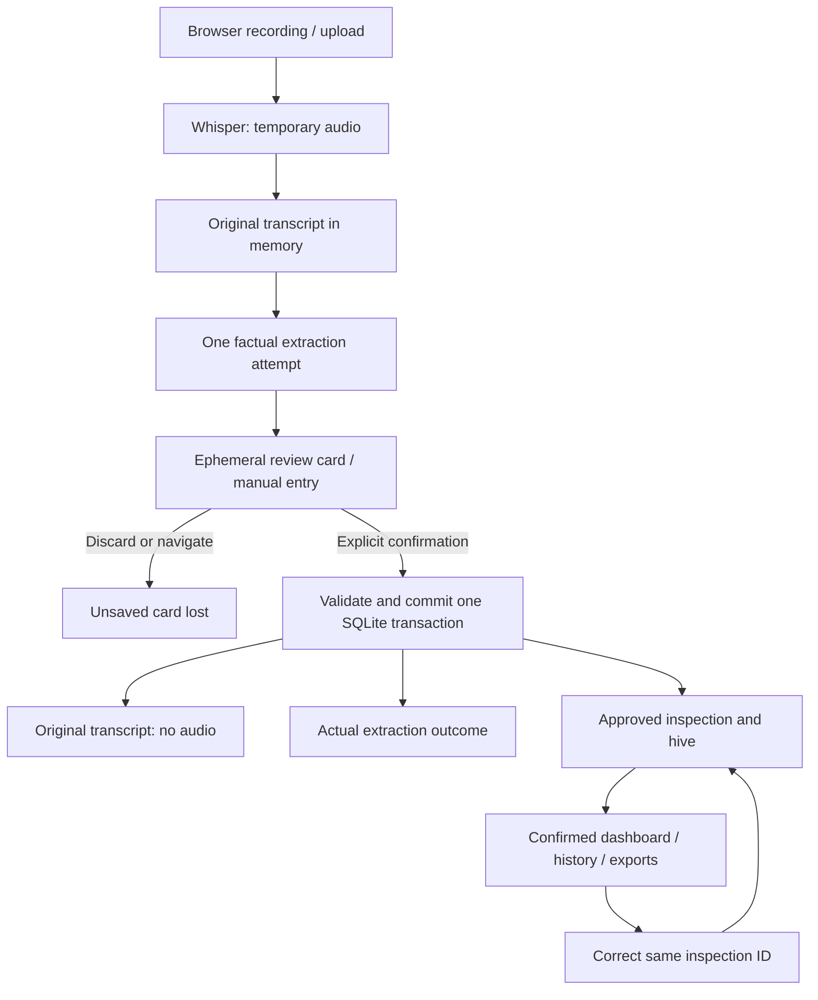

# Architecture

Yard Assistant is a self-hosted voice logbook using FastAPI, Jinja2, browser
JavaScript, local Whisper/Ollama and the existing SQLite v2 database.
See [YA-02](ya-02.md) for current behavior and operating instructions.

No transaction spans a model request. Signed review content is kept only in the
active browser page; there is no durable draft or server session store.
`BEGIN IMMEDIATE` serializes idempotency lookup and confirmation writes. Confirmed
facts can be corrected; original transcript and inspection/hive/source IDs cannot.

Jinja2 renders persisted dashboard/history cards; the shared browser editor
renders temporary reviews and edits confirmed records. Pydantic defines the
factual validation contract; presentation labels and grouping stay separate.

SQLite tables, constraints and version remain unchanged. Application queries
filter approved records instead of changing the legacy latest-inspection view.
Existing YA-01 records are preserved for explicit review. Startup only verifies
schema compatibility, with no automatic initialization, migration or cleanup.

The earlier PNG/drawio diagrams in this folder describe historical infrastructure;
the flow above is authoritative for current persistence behavior.
