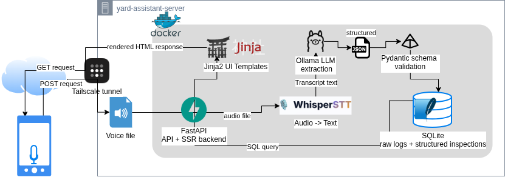

# Architecture

Yard Assistant is a self-hosted, voice-first beekeeping logbook. It uses a server-side rendered UI for simple dashboard pages and a local AI pipeline for converting audio notes into structured inspection records.

## High-Level Architecture



GET requests render dashboard pages server-side using FastAPI, SQLite, and Jinja2.

POST requests upload audio notes to FastAPI. The backend passes audio to Whisper for transcription, sends the transcript to Ollama for structured extraction, validates the result with Pydantic, and stores both raw and structured records in SQLite.

## Request Flow

### Dashboard / Read Flow

```text
Phone / Browser
    |
    | HTTPS via Tailscale
    v
FastAPI App
    |
    | SQL query
    v
SQLite
    |
    | query results
    v
FastAPI App
    |
    | render template
    v
Jinja2 UI
    |
    | rendered HTML response
    v
Phone / Browser
```

### Voice / Write Flow

```text
Phone / Browser
    |
    | audio upload via HTTPS / Tailscale
    v
FastAPI App
    |
    | audio file
    v
Whisper STT
    |
    | transcript text
    v
Ollama / Llama
    |
    | structured JSON
    v
Pydantic Validation
    |
    | validated structured data
    v
SQLite
```

## Component Responsibilities

| Component | Responsibility |
|---|---|
| FastAPI | API and server-side rendered backend |
| Jinja2 | HTML template rendering |
| Whisper STT | Audio-to-text transcription |
| Ollama / Llama | Local LLM-based structured extraction |
| Pydantic | Schema validation and data normalization |
| SQLite | Stores raw logs and structured inspection data |
| Tailscale | Secure HTTPS access for browser microphone support |